# Meet Budy — Project Documentation

## Document scope and reading guide

A practical guide to installing, using, understanding, and maintaining MeetBud.

| Document detail | Value |
| --- | --- |
| Product name | Meet Budy; older text also says Meet Recorder |
| Repository | MeetBud |
| Extension version | `1.0.0`, from `manifest.json` |
| Browser architecture | Chrome Manifest V3 |
| Source reviewed | `3b898440a52e192138f93b281b3566c81fa38c5e` |
| Prepared | November 12, 2026 |
| Intended readers | Users, project reviewers, and developers |

MeetBud records a Google Meet presentation and selected meeting audio inside the browser. This guide explains the complete path from incoming WebRTC media to locally stored chunks, downloaded recordings, and an optional combined MKV file.

This guide follows the reviewed source and explains material differences from historical README warnings. Automated verification and remaining real-meeting limits are identified where relevant.

**Screenshots:** the actual unpacked extension was opened in an isolated Chromium profile without joining a meeting. Zero stream and voice counts are expected.

**Code examples:** excerpts identify their source function. Any shortened or illustrative example is labeled; command-line examples describe a manual workflow rather than a built-in shell operation.

## Contents

| Topic | Sections |
| --- | --- |
| Getting started | [Overview](#purpose-and-advantages), [technologies](#technologies-and-repository-layout), [installation](#installation-and-update-procedure), [workflow](#a-complete-recording-workflow) |
| Extension interface | [Popup](#extension-interface-screenshot), [controls](#controls-and-configuration), [audio settings](#audio-track-settings-screenshot) |
| Architecture | [Execution contexts](#the-four-execution-contexts), [messages](#injection-and-message-routing), [WebRTC capture](#capturing-live-webrtc-media) |
| Video and audio | [Presentation detection](#finding-the-presentation-video), [canvas](#canvas-composition-and-video-continuity), [mixing](#the-web-audio-mixing-engine), [microphone](#local-microphone-and-recording-mute) |
| Voice isolation | [Participant mapping](#matching-audio-tracks-to-people), [large-meeting limitations](#why-voice-separation-fails-in-large-meetings) |
| Recording pipeline | [Startup](#starting-an-owned-recording-session), [chunks](#what-recording-chunks-really-are), [storage](#writing-chunks-to-indexeddb), [finalization](#stopping-and-draining-final-chunks), [downloads](#assembling-and-downloading-raw-files), [playback](#duration-metadata-and-playback), [outputs](#parallel-audio-recordings-and-output-files) |
| FFmpeg | [Setup](#installing-the-optional-ffmpeg-core), [browser pipeline](#the-browser-ffmpeg-merge-pipeline), [stream mapping](#ffmpeg-stream-mapping-explained), [manual commands](#manual-ffmpeg-repair-and-merging) |
| Recovery | [Saved recordings](#saved-recordings-and-deferred-combining), [ownership and cleanup](#recovery-and-cleanup-ownership), [resource lifetimes](#resource-lifetimes-and-leak-prevention) |
| Maintenance | [Performance](#performance-and-storage-planning), [troubleshooting](#troubleshooting-and-known-limitations), [verification](#verification-and-development-guide), [privacy and references](#privacy-glossary-and-references) |

Start with installation and the recording workflow. Read participant mapping and large-meeting limitations before relying on named or VIP-only outputs.

## Purpose and advantages

MeetBud captures media already available to the Google Meet page. It draws the chosen presentation into a canvas, builds audio mixes with Web Audio, and records those outputs with the browser's `MediaRecorder` API. The extension can also record its background view when no presentation is available.

Its main advantages are practical:

- **Local processing:** recording storage, file assembly, and optional FFmpeg combining happen on the device. The extension contains no recording-upload feature.
- **Direct setup:** the source folder loads as an unpacked extension, without a bundler, application server, package installation, or build command.
- **Incremental saving:** chunks are committed to IndexedDB during capture, reducing dependence on one large in-memory recording buffer.
- **Flexible outputs:** a main mix can coexist with extra audio mixes for VIPs, the local microphone, or resolved participant names.
- **Video continuity:** a stable canvas stream lets a recording switch between a presentation and a background without replacing its recorder input.
- **Optional combining:** raw outputs are downloaded before a combined file is attempted, preserving a usable fallback when FFmpeg is unavailable.
- **Recovery catalog:** saved recordings remain individually discoverable across later recordings and page reloads.

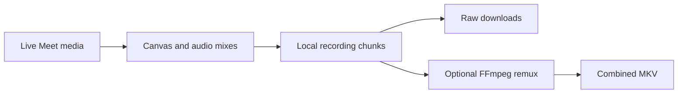

## Technologies and repository layout

The project uses browser-native APIs and plain JavaScript. It has no React, backend service, database server, or application build pipeline.

| Technology | Role in MeetBud |
| --- | --- |
| Manifest V3 | Extension permissions, injection rules, popup, service worker |
| JavaScript, HTML, CSS | Capture logic, storage bridge, and popup interface |
| WebRTC | Incoming audio/video tracks and outgoing microphone senders |
| Web Audio API | Source nodes, gain routing, analysers, audio destinations |
| Canvas 2D and `captureStream()` | Stable composited video input |
| `MediaRecorder` | Encodes the main output and extra audio outputs |
| IndexedDB | Stores media chunks on the Meet origin |
| `chrome.storage.local` | Preferences, recording state, recovery job metadata |
| `postMessage` and extension messages | Communication between execution contexts |
| Blob URLs and Workers | Downloads, compositor timing, optional FFmpeg worker |
| FFmpeg compiled to WebAssembly | Remuxes existing media into a combined MKV |
| Node.js built-in test runner | Source-executing lifecycle regression tests |
| Mermaid | Diagrams in this documentation |

```text
MeetBud/
├── manifest.json          Extension configuration
├── injected.js            Page-world capture, mixing, and recording
├── content_script.js      Bridge, assembly, downloads, and recovery
├── background.js          Command relay and durable job ownership
├── muxer.js               Optional FFmpeg worker wrapper
├── popup/                 Popup HTML, CSS, and JavaScript
├── vendor/ffmpeg/          Optional core JavaScript and WebAssembly
├── tests/                 Lifecycle tests and simulated API fixtures
├── icons/                 Extension toolbar icons
└── docs/                  Supporting reports and screenshots
```

## Installation and update procedure

Use desktop Chrome or a Chromium browser whose extension and media APIs you have validated. Other browsers and mobile environments are not established by this repository as fully supported configurations.

1. Obtain the MeetBud folder and locate `manifest.json` at its root.
2. Open `chrome://extensions`.
3. Enable **Developer mode**.
4. Click **Load unpacked** and select the project root.
5. Pin the Meet Budy toolbar icon.
6. Open or reload Google Meet after the extension is installed.
7. Join a short test meeting and inspect stream and voice counts in the popup.

The extension matches `https://meet.google.com/*` and loads its content scripts at `document_start`. Early injection matters because its page script wraps peer connections that Meet creates. Loading it after a call has already initialized may leave media undiscovered, even though a rescan can find some streams attached to existing media elements.

**After an extension update:** stop and save any active recording, reload the extension in `chrome://extensions`, and hard-refresh the Meet page with `Ctrl+Shift+R` or the platform equivalent. An extension reload alone does not replace scripts already running in the page.

Before an important meeting, confirm that:

- The popup communicates with the correct Meet tab.
- Available audio sources appear and a short recording contains sound.
- A presentation is detected when one is actually being shared.
- Browser downloads work and enough disk space is available.
- Any extra audio outputs and FFmpeg setup work in your browser.

Node.js 18 or later is needed only for automated tests. Optional combining requires [FFmpeg setup](#installing-the-optional-ffmpeg-core).

## Extension interface screenshot

| Main popup | Settings modal |
| --- | --- |
| 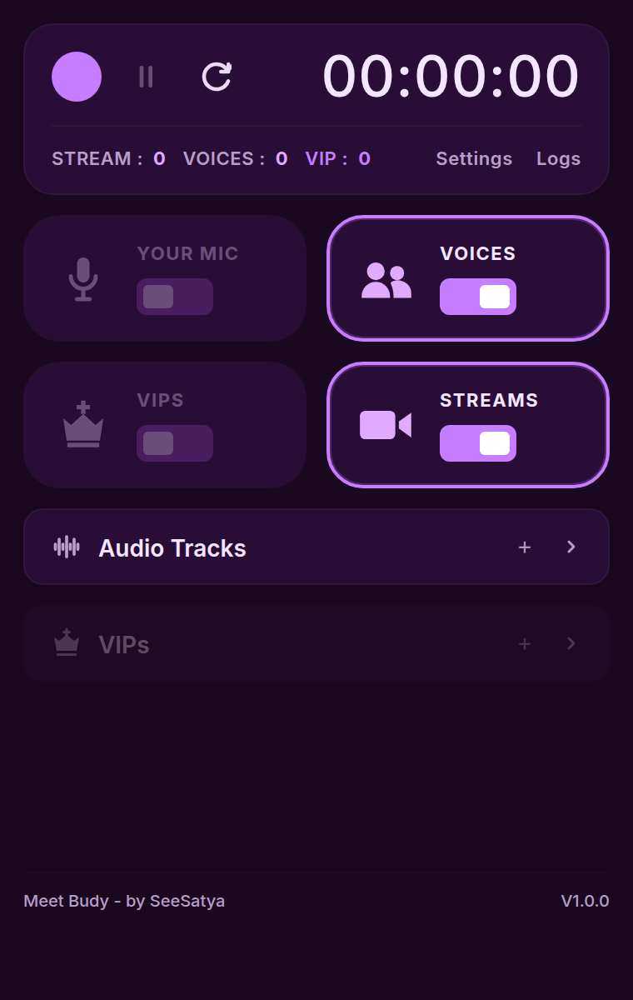 | 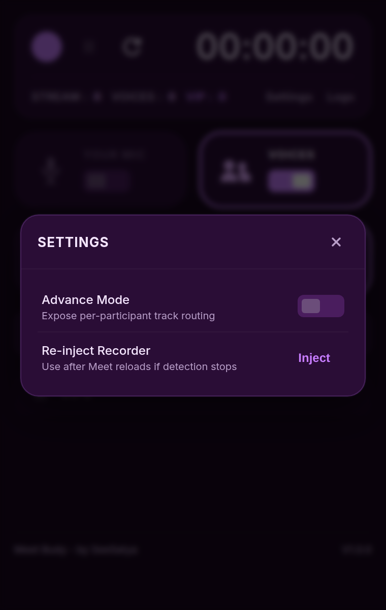 |

*Figure 1. Actual unpacked extension popup and Settings modal. The zero counters reflect the absence of a Meet call.*

The top card contains the circular record control, pause/resume control, refresh control, and recording timer. The counters describe detected presentation streams, captured audio sources, and configured VIP information. An audio-source count is not an independently verified participant count.

The main switches control the local microphone, recording voices, VIP behavior, and presentation display. Audio Tracks and VIPs open configuration areas beneath them. Settings exposes additional controls; Logs shows diagnostic events and chunk progress.

## Controls and configuration

| Control | Meaning | Default |
| --- | --- | --- |
| Record button | Starts a session; during recording, stops and saves | Idle |
| Pause/resume | Changes the active main and secondary recorders | Disabled when idle |
| Reload Streams & Voices | Requests status and rescans visible media | Available |
| YOUR MIC | Permits eligible outgoing Meet microphone audio | Off |
| VOICEs | Opens or closes the recording audio gates | On |
| STREAMs | Permits presentation video; off forces background view | On |
| VIPs | Enables VIP-dependent selection/routing | Off |
| Audio Tracks | Configures output mixes | One `EVERYONE` track |
| Settings | Opens Advance Mode and re-injection controls | Closed |
| Logs | Displays recent diagnostic messages | Closed |

VOICEs changes the recorded output, not the audio participants hear inside Meet. YOUR MIC uses the microphone track Meet is already sending; it does not independently acquire a microphone. Turning STREAMs off changes what the canvas draws, without removing the recorder's canvas video track.

Configure output mixes before starting. The accepted session takes a snapshot of its output IDs, names, and target lists. Editing the output configuration during recording prepares the next session and preserves the active session's output identity through final save. Microphone, voice mute, and VIP controls have separate live routing effects.

Pause/resume is implemented and covered by simulated lifecycle tests. The historical README reports pause problems; native browser scheduling, media duration, and playback after pauses still need a real test. The wall-clock popup timer should not be assumed to equal encoded media duration.

Advance Mode is stored as a UI preference; the source does not establish a separate recording engine behind it. Re-injection has duplicate-installation guards, but extension reload plus a fresh Meet page remains the clearest standard recovery procedure outside an active recording.

## Audio track settings screenshot

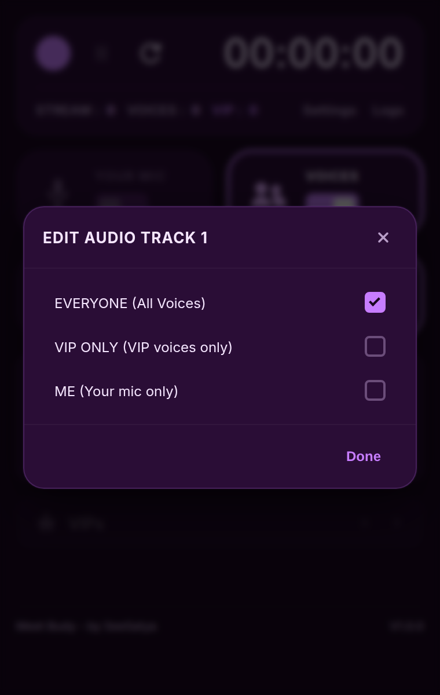

*Figure 2. Actual track editor opened from the default track. The browser has no active meeting, so it cannot list real participant names.*

Targets define which captured sources feed an output. `EVERYONE` includes available remote sources, `VIP_ONLY` requires resolved VIP identities and VIPs enabled, and `ME` requires an eligible local microphone with YOUR MIC enabled. Named targets require a matching resolved participant identity.

A newly added track starts without targets. Select its inputs before recording; an empty target list produces a muted output. The UI keeps at least one configured output and renumbers tracks after additions or removals.

For predictable capture, retain the broad main mix and add specialized mixes only after testing them. The editor's participant list depends on available identity metadata, so it may be incomplete in a large meeting.

## A complete recording workflow

1. Join Meet after installing or refreshing the extension.
2. Open the popup and refresh stream status.
3. Keep VOICEs enabled; decide whether YOUR MIC should be included.
4. Set output tracks and VIP targets before capture.
5. If recording a presentation, confirm that a real share is detected.
6. Start recording and inspect Logs for saved chunks and increasing file size.
7. Stop while the Meet page remains open.
8. Wait for raw file assembly and download initiation.
9. Open the downloaded main file and check picture, sound, and seeking.
10. With multiple outputs, choose whether to combine now, defer, or keep the raw files.

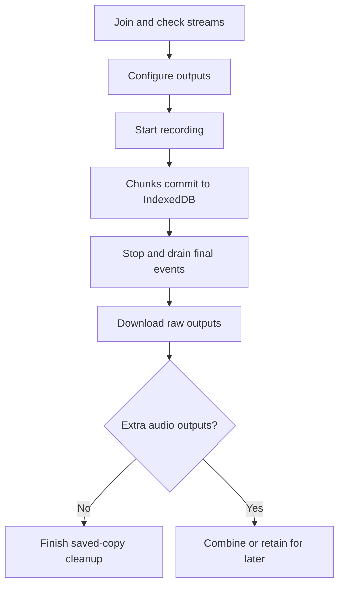

The popup can close while the page continues recording. Reopening it restores extension recording state and requests fresh status. The Meet page itself owns the recorders and must remain alive.

**Stop before leaving the call, closing the tab, refreshing the page, or restarting Chrome.** Recovery can retrieve committed chunks, but cannot recreate uncommitted media or a recorder's missing final events. A download notification from this extension means the browser was asked to start a download; verify the actual file in Chrome's downloads and on disk.

## The four execution contexts

MeetBud separates capture from extension privileges. Each context has different API access and a specific ownership role.

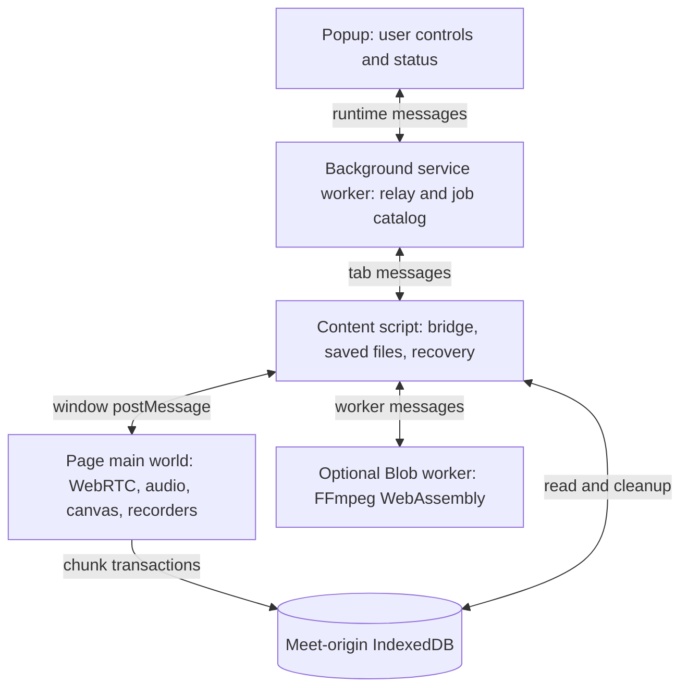

`injected.js` runs in the page's main world, where it can wrap the peer-connection constructor used by Meet. It owns live sources, the mixing graph, the compositor, recording sessions, and the active chunk-write path. It has no extension `chrome.*` APIs.

`content_script.js` runs in the extension's isolated world on the Meet origin. It injects the main-world script, bridges messages, reads saved chunks, fixes duration metadata, starts downloads, and coordinates optional combining. Both worlds can access the page-origin IndexedDB database.

`background.js` is an event-driven Manifest V3 service worker. It relays commands, stores recording state, and serializes revision-checked recovery job changes. It routes actions to an appropriate Meet tab rather than owning the media itself.

`popup/popup.js` renders controls and dispatches commands. Closing the popup destroys that UI instance without directly stopping page-owned recording.

`muxer.js` belongs to the content-script environment and creates a dedicated worker for optional FFmpeg operations. That worker is an additional processing component, not another user interface context.

## Injection and message routing

A content script cannot replace the page's JavaScript globals from its isolated world. MeetBud therefore inserts `injected.js` as a page script, using the extension's web-accessible resource URL. A readiness handshake confirms that the page recorder is available before queued commands are flushed.

The injection path bounds retries to five attempts and the pending command queue to 32 entries. Each retired attempt releases its script element, handlers, and timer. Guards prevent repeated installation of the page wrapper, bridge, and managed muxer.

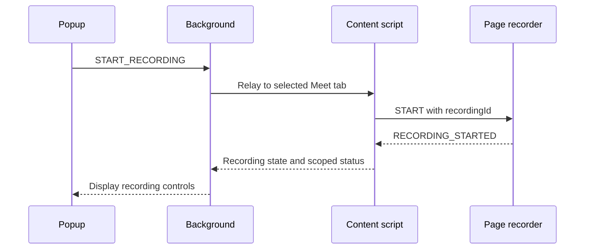

Commands sent to the page carry the source marker `MEET_REC_CMD`. Page events carry `MEET_REC_PAGE`. Source markers identify message conventions; they are not secret authentication credentials.

Important command families include start/stop/pause/resume, status and rescan, audio-track configuration, VIP configuration, microphone and recording-mute controls, and saved-recording actions. Background commands such as `START_RECORDING` are translated into page commands such as `START`; the exact names are context-specific.

Status includes recording, tab, bridge-context, and job scope where applicable. Those identities prevent an old download callback or another tab's event from resetting a newer recording's controls. A new feature that crosses contexts needs a compatible handler at each relevant hop, not only a popup button.

## Capturing live WebRTC media

Google Meet does not expose a normal downloadable movie URL for a live call. The browser receives real-time media through WebRTC peer connections. MeetBud observes tracks inside the page, then records its own composed output.

**Source excerpt — `injected.js`, peer-connection wrapper:**

```javascript
const PatchedRTCPeerConnection = function(config, constraints) {
  const pc = Reflect.construct(
    OrigPeerConn, [config, constraints],
    new.target || PatchedRTCPeerConnection
  );
  patchPeerConnection(pc);
  return pc;
};
PatchedRTCPeerConnection.prototype = OrigPeerConn.prototype;
Object.setPrototypeOf(PatchedRTCPeerConnection, OrigPeerConn);
window.RTCPeerConnection = PatchedRTCPeerConnection;
```

`Reflect.construct` creates a real underlying peer connection while preserving constructor behavior. The wrapper installs observation logic on each new connection. The surrounding source also copies selected static properties and wraps explicit peer closure for retirement.

The registered `track` listener records track ownership and the first available stream ID, then sends audio to `addAudioTrack()` or video to `addVideoTrack()`. Duplicate track IDs are ignored. Ended tracks and genuinely closed peers release recorder-owned observation resources.

A rescan can also inspect the `srcObject` streams attached to existing `<audio>` and `<video>` elements. This is a fallback for visible media, not a guarantee that every earlier connection can be reconstructed.

The recorder receives media already decoded and delivered to the page. It does not download RTP packets, bypass Meet transport encryption, request recordings from a server, or retrieve media that the browser never received. The two-second recording chunks described later are newly encoded local output, separate from WebRTC's network packet structure.

## Finding the presentation video

The recorder must distinguish a presentation from camera video. It combines WebRTC track hints, media dimensions, labels, and Meet DOM information rather than relying on one fixed selector.

`probeVideoTrack()` attaches a temporary muted video element to a received track. It checks metadata and dimensions after several delays—300, 800, 1,500, 3,000, 6,000, and 12,000 milliseconds—and has a final cleanup timer. Metadata and resize events can trigger checks sooner. A confirmed share remains available to the compositor; a rejected camera probe is retired while the track's ordinary lifetime observation remains.

Signals include `contentHint` values such as `detail` or `text`, screen-related labels, display-surface metadata, and dimensions consistent with a presentation. A DOM fallback searches media elements and presentation-related labels. Zero initial dimensions are treated as provisional because Meet can attach video before frames arrive.

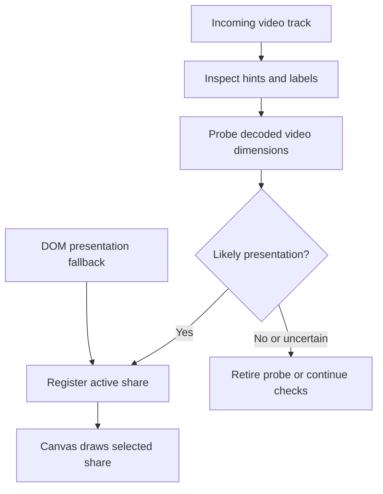

These are heuristics. A high-resolution camera can look like a share, a low-resolution presentation can be missed, and Meet can change its DOM or labels. The recorder also selects one presentation for its canvas; it does not build a multi-presentation editing timeline.

When an observed share ends, the code can fall back to another registered active share or the background view. STREAMs off explicitly forces the background. Validate share appearance, disappearance, and replacement in a real meeting before relying on these transitions for a long session.

## Canvas composition and video continuity

Recording a stable canvas stream lets the extension change visible content without replacing the main recorder's video track. At startup it creates a canvas, locks its output dimensions, and uses `captureStream(30)` to produce video frames.

The default size is 1920 × 1080. If a detected presentation already has valid dimensions at startup, the session uses those dimensions. Resolution stays locked during that session. Presentations with different aspect ratios are fitted into the fixed recording area rather than changing the recording container partway through.

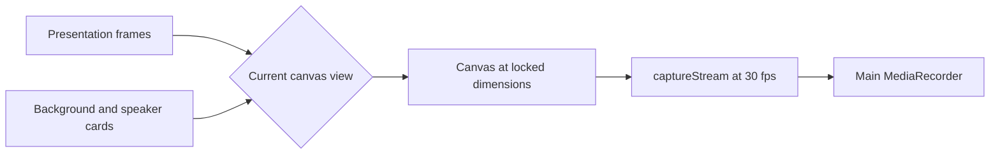

When a presentation is available and enabled, the compositor draws it. Otherwise it draws the bundled background and available speaker information. Speaker cards are deliberately rendered only when no presentation is being drawn, so they do not cover slides.

The drawing loop uses a timer worker where possible, with a fallback when worker creation fails. A worker can improve scheduling isolation, but it does not make main-thread canvas drawing immune to CPU pressure or guarantee perfect 30-fps delivery.

The recorded visual is the compositor output, not a pixel-for-pixel capture of the whole Meet tab. Chat, browser controls, and the entire camera grid are not intended recording sources. Heuristic share selection can still select the wrong video.

## The Web Audio mixing engine

Every available remote audio track is connected to one reusable Web Audio source. Per-source gain nodes route it into selected output mixers; output gates decide whether the recording receives sound.

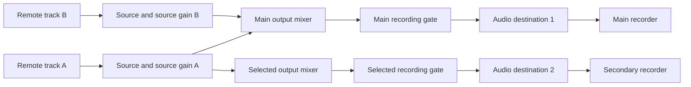

A destination's stream supplies one audio track to its recorder. Mixing multiple captured sources into that destination produces one combined audio signal. Multiple output destinations can receive overlapping sources.

`rebuildAudioGraph()` disconnects prior routing and reconnects sources according to the session's selected targets. `EVERYONE` permits a remote source without a participant-name match. Named and VIP-only outputs require usable identity mapping, making them more fragile in large calls.

The project preserves two browser-specific behaviors identified in its source and development notes. A hidden muted `<audio>` element is attached to each remote stream to prime audio delivery for Web Audio. The level analyser taps the same source node used for recording rather than constructing a second source for that track. Removing these arrangements can produce silence in the affected Chrome path.

Analysers estimate energy for speaker activity; one shared loop polls them roughly every 100 milliseconds. These estimates help visualization and diagnostics. They do not extract one person's voice from a mixed source or establish a reliable identity by themselves.

Output gates start at gain zero and open for recording unless recording mute is enabled. This prevents idle graph activity from being confused with recorded output and supports mute without destroying live source ownership.

## Local microphone and recording mute

Remote meeting audio and the user's own outgoing microphone follow different paths. The local microphone defaults to off in the recorder even if the user is speaking in Meet.

When YOUR MIC is enabled, the extension inspects senders on observed peer connections and looks for an eligible live outgoing audio track. It uses that track in the local Web Audio source path. The source does not call `getUserMedia()` to acquire a separate microphone solely for this feature.

To record yourself, Meet must provide a live usable sender track, YOUR MIC must be enabled, recording audio must be unmuted, and at least one output must accept `ME`, `EVERYONE`, or the resolved local name. A disabled, absent, or otherwise silent Meet sender can still produce no audible local recording.

| Situation | Expected recorder effect |
| --- | --- |
| YOUR MIC off | Local sender audio is excluded |
| YOUR MIC on, `ME` selected, usable sender | Local source can feed that output |
| VOICEs off | Recording audio gates close for all outputs |
| STREAMs off | Background video is drawn; audio routing is independent |
| Named remote output | Requires a resolved remote identity |

**Illustrative routing condition, shortened from `rebuildAudioGraph()`:**

```javascript
if (recordMyMic && !isRecordingMuted && localMicGainNode) {
  if (includeEveryone || includeMe || targets.includes(localName)) {
    localMicGainNode.connect(targetMixer);
  }
}
```

Muting recording voices is independent of Meet's microphone button. It silences the recording destinations and does not mute other participants in the call. Conversely, unmuting a recording cannot create audio from a source that Meet is not sending or the browser is not receiving.

The old README's statement that the user's microphone is “never” recorded is incomplete for this implementation: optional sender-based local capture exists. Test microphone-on, Meet-muted, and microphone-off cases so the saved file matches your intent.

## Matching audio tracks to people

An audio track ID is a browser media identifier, not a person's name. MeetBud tries to associate it with a participant using track-to-stream metadata, visible media elements, tile information, and cached identities.

`getParticipantForTrack()` first inspects available remote tiles. When it sees exactly one remote tile, it attributes remote audio to that name. It then tries track-keyed cache entries, stream-keyed cache entries, direct track matches in media elements, and matching stream IDs. Cached identities that appear to be the local user are rejected where appropriate.

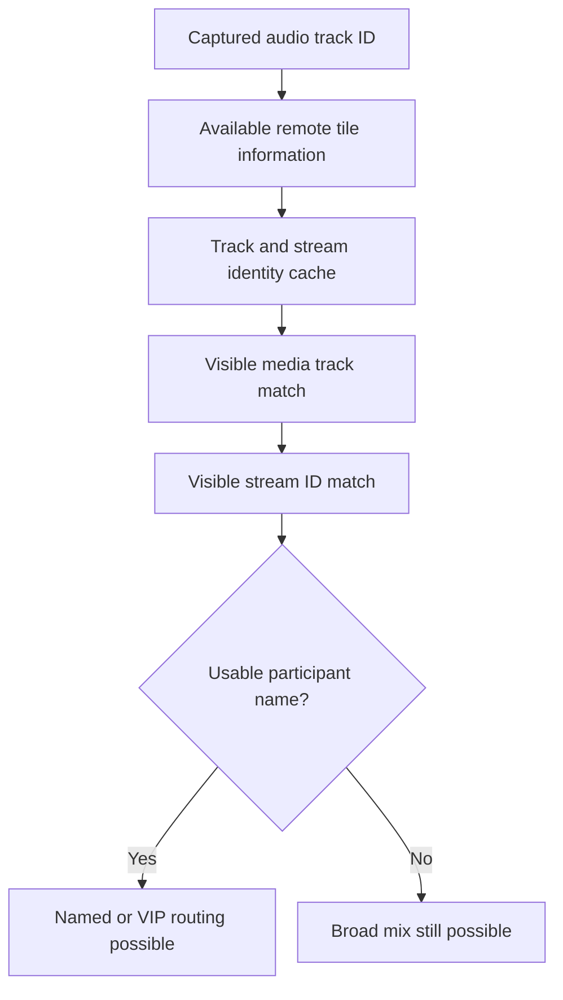

Tile name resolution uses signals such as accessible “More options for …” labels and avatar elements. Local-user detection also uses self-only interface cues. These are Meet UI details, not an official participant-identity API.

The single-visible-tile shortcut is a significant caveat. In a small call it may work well; in a virtualized large meeting, one visible remote tile does not prove there is only one remote speaker. Visibility and identity can diverge, causing an incorrect attribution.

Participant names can also be duplicated, missing, changed, or rejected by name filters. A camera-off participant may lack the video element needed for a stream match. Changing layouts can invalidate what is visible, and stale cache information can persist until updated.

A speaker highlight or volume estimate is useful evidence of activity, but is not proof that a specific independent audio source belongs exclusively to that highlighted person. Named routing should therefore be treated as a best-effort feature.

## Why voice separation fails in large meetings

**MeetBud does not reliably produce one isolated voice recording per person in a large meeting.** The project's historical README reports individual recording working only around three or four people. That is an observed warning, not a tested numeric compatibility limit: the source does not impose a hard four-person threshold.

The implemented feature routes captured audio sources. It contains no speech-separation model, voice recognition system, speaker diarization pipeline, or reconstruction of missing participant media. A source can only be selected separately when usable media and identity information are available separately.

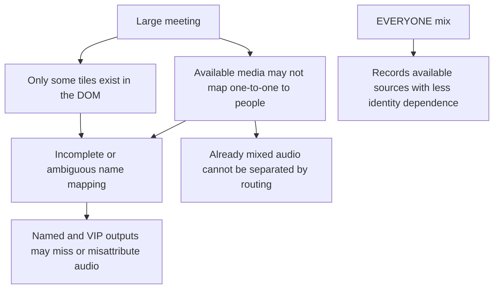

Meet virtualizes its interface: in a call of 80 or more participants, the development notes describe roughly three to nine tiles in the DOM at a time. Scraping those tiles cannot enumerate the complete call. Subscription changes, camera-off participants, stream reuse, and layout changes add uncertainty. The repository does not establish the exact server-side audio topology for every Meet configuration; do not assume every source is independent or that every call is server-mixed.

If one received source already contains multiple voices, connecting it to several output mixers copies that mixture. FFmpeg later preserves those encoded signals; it cannot turn them into separate speakers.

For a large call, keep an `EVERYONE` output as the baseline, test named/VIP tracks with the actual layout, and expect incomplete separation. Reliable individual isolation would require dependable independent upstream media and identities, or a separate post-processing system with its own accuracy limits. Adding more output tracks alone does not solve the problem.

## Starting an owned recording session

`startRecording()` reserves a session synchronously before allocating resources or awaiting audio-context startup. Another START is rejected while that session is starting, recording, or finalizing. This prevents parallel startups from sharing IDs, canvases, or output metadata accidentally.

**Source excerpt — `injected.js`, session reservation:**

```javascript
if (activeRecordingSession) {
  postOut('WARN', 'Recording is starting, active or finalizing');
  return;
}
const session = {
  id: recordingId, state: 'starting',
  outputs: customAudioTracks.map(track => ({
    ...track, targets: Array.from(track.targets || []),
  })),
  recorders: [], main: null, writes: new Set(), kickNodes: [],
  started: false, writeFailed: false, disposed: false,
};
activeRecordingSession = session;
```

The function then allocates the locked canvas, chooses a supported MIME type, resumes Web Audio if necessary, rebuilds accepted routing, and obtains the canvas video track. The main recorder combines that video with the first output's destination audio. Additional outputs receive audio-only recorders.

Requested rates are 3,000,000 bit/s for main video and 128,000 bit/s for each output's audio. Each successfully started recorder uses `start(2000)`, requesting approximately two-second data intervals.

Startup checks its session identity again after an awaited audio-context resume. A STOP issued during that wait can cancel startup; the late resume must not revive a retired session or affect a newer one.

Failures are rolled back through finalization. A secondary recorder's initialization or start failure is reported without requiring the main output to fail. The completion metadata lists only started secondary outputs, so an output that was configured but failed to start may not appear in the saved files.

## What recording chunks really are

The phrase “download WebRTC chunks” can be misleading. WebRTC brings live media to the page; MeetBud creates its own encoded recording chunks with `MediaRecorder`. It saves those chunks to browser storage and downloads assembled files after stopping.

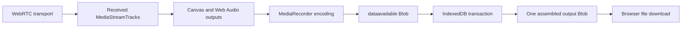

`start(2000)` requests a two-second timeslice. The browser may emit a chunk later under load, during tab throttling, or around pause/resume. Chunk count multiplied by two is therefore not a precise duration measurement.

The `dataavailable` event supplies a Blob containing a portion of the recorder's encoded container stream. The first chunk usually contains initialization/header information; later chunks continue that same recording. Individual chunks are not guaranteed to be independently playable files.

This distinction affects merging. Chunks from **one recorder session** are reassembled in their original order into that session's complete stream. Main video and separately recorded audio outputs are **simultaneous streams**, which FFmpeg maps into one container. These operations solve different problems.

Do not use FFmpeg's concat demuxer as the default method for arbitrary two-second MediaRecorder chunks. It expects independently demuxable media inputs and can fail when a later chunk lacks its own header. MeetBud itself does not run FFmpeg once per chunk and does not write each chunk as a separate browser download.

## Writing chunks to IndexedDB

The active writer is in `injected.js`. It writes Blobs directly to `MeetRecorderDB`, version 1, object store `chunks`. The store has auto-increment primary keys and a non-unique `by_recording` index on `recordingId`.

**Source excerpt — `writeChunkOnce()` transaction body:**

```javascript
const store = tx.objectStore(IDB_STORE);
const req = store.add({ recordingId, data: chunkData });
req.onerror = () => reject(req.error);
tx.oncomplete = () => resolve();
tx.onerror = () => reject(tx.error);
tx.onabort = () => reject(
  tx.error || new Error('Chunk transaction aborted')
);
```

Completion is acknowledged when the transaction commits, rather than merely when the add request succeeds. `persistRecordingChunk()` tracks accepted write promises in the owning session. Counters increase after successful commits, and a failed write sets `session.writeFailed` and emits an error.

| Stored item | Purpose |
| --- | --- |
| Auto-increment primary key | Stable insertion order within a recording |
| `recordingId` | Groups chunks belonging to one output |
| `data` | The encoded Blob for that chunk |
| `by_recording` index | Reads/deletes all chunks for an output ID |

The main output uses the session ID. Additional audio outputs use IDs such as `session123__t2`, preserving the session/output relationship. No explicit media timestamp or chunk sequence field is stored in each row; assembly uses indexed records ordered by their primary keys.

The page and isolated content-script worlds share the Meet-origin database. Large recording Blobs therefore do not need to cross the page-to-extension message bridge; successful-write events provide UI counters instead. Older helper code in the content script should not be mistaken for the primary active write path.

A stale or closing database connection is reopened and retried once. Other transaction errors remain meaningful failures. Browser storage quotas and user-cleared site data can still affect saved recordings; IndexedDB is resilient storage, not an unlimited archive.

## Stopping and draining final chunks

STOP begins a finalization operation; it is not proof that all recording data is already available. `MediaRecorder.stop()` can deliver final `dataavailable` and `stop` events asynchronously, and accepted IndexedDB transactions may still be pending.

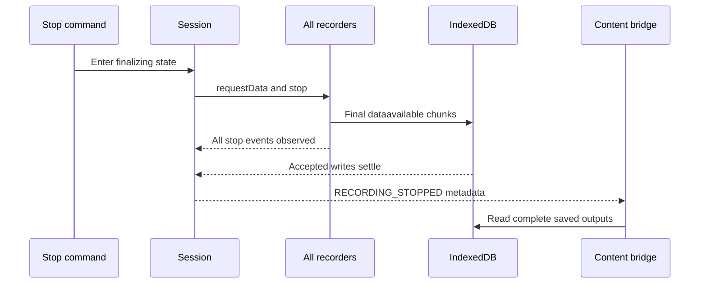

`finalizeRecording()` creates its shared finalization promise before stopping recorders. Reentrant or repeated callbacks reuse that operation. It closes recording gates, stops drawing, and requests data/stop independently, so a `requestData()` exception does not skip the stop request.

**Source excerpt — finalization drain:**

```javascript
await Promise.all(
  session.recorders.map(entry => entry.stoppedPromise)
);
releaseSessionCapture(session);
while (session.writes.size) {
  await Promise.all(Array.from(session.writes));
}
```

Native canvas capture can be released after final media events, while the session retains identity until writes drain. The completion event carries the immutable recording ID, MIME type, saved counts, `writeFailed`, and started secondary-output metadata.

If a write failed, the bridge preserves saved data for recovery and warns that output may be incomplete. It does not silently declare a complete save. A forcibly closed tab can bypass this entire drain, which is why normal Stop remains necessary even with incremental persistence.

## Assembling and downloading raw files

`assembleAndDownload()` in `content_script.js` loads rows for one `recordingId` through the `by_recording` index. Equal index keys are ordered by their auto-increment primary keys, preserving the accepted insertion order for the recording.

It optionally patches the first Blob's duration metadata, then constructs a final Blob from the ordered buffers. Blob construction joins the bytes belonging to the same recording; it does not decode or re-encode the captured media.

**Source excerpt — assembled Blob and download URL:**

```javascript
const finalBlob = new Blob(buffers, {
  type: mimeType || 'video/webm'
});
// downloadBlob() creates a temporary anchor:
const url = URL.createObjectURL(blob);
a.href = url;
a.download = filename;
document.body.appendChild(a);
a.click();
```

The source derives an extension from the recorded MIME type, sanitizes the output label, and names the main download like `meet-recording-<timestamp>_full.mkv` or `_full.webm`. Extra audio downloads use `_track-<id>-<name>.webm`.

The temporary download anchor is removed and its Blob URL is revoked after approximately three seconds; failure before scheduling that disposal releases it immediately. The current download path uses an anchor even though the manifest declares the downloads permission.

The stopped-session handler saves raw outputs with `keepChunks: true`. It downloads the main file and then started secondary files before deciding whether the retained copy should remain for combining or be cleaned up. A normal single-output session proceeds to cleanup after raw-save initiation.

Empty data and storage read errors are handled separately. A read failure must not be treated as proof that there are no chunks to recover. Browser policies, disk exhaustion, or canceled downloads can still prevent a usable file from appearing. The extension reports initiation; inspect Chrome's downloads and playback before depending on the file.

## Duration metadata and playback

MediaRecorder output may lack the duration metadata and finalized indexing expected by some players. A file can contain real media while showing an unknown duration, awkward seeking, or poor compatibility in a particular player.

Before raw main-file assembly, the bridge attempts `fixWebmDuration()` on the first Blob when duration fixing is enabled and elapsed time exceeds one second. It parses EBML structures and patches or inserts duration information. Remaining chunks are then joined behind that first chunk.

This is a metadata operation, not a full re-encoding or rebuilding of every cluster and seek cue. Some status text calls it “Injecting seek index (duration),” but that wording should not be read as a complete container-index repair. Failure to patch is logged, and assembly continues with the available bytes.

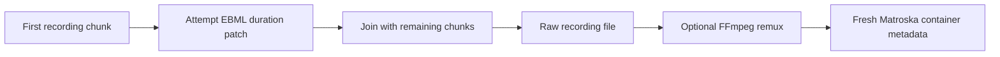

The duration calculation uses wall-clock elapsed time from the stored start timestamp. Pauses, delayed recovery, or browser scheduling can make that value differ from actual encoded media duration. Secondary audio downloads disable this first-chunk duration patch in the normal workflow.

The extension chooses among supported MIME types: Matroska with H.264/Opus, WebM with H.264/Opus, VP8/Opus, VP9/Opus, and plain WebM. Availability depends on the browser. The selected MIME, not a fixed assumption about Chrome codecs, controls the raw main file's extension.

FFmpeg remuxing can improve compatibility by demuxing the available media and writing a fresh Matroska container. It does not guarantee repair of missing headers, corrupt packets, timestamp discontinuities, or lost chunks. Check beginning, middle, end, seeking, and each audio output in a real player.

Renaming a file from `.webm` to `.mkv` is not equivalent to remuxing it. Names describe a file; FFmpeg actually writes container structures.

## Parallel audio recordings and output files

MeetBud avoids relying on a single browser recorder to produce a portable file with all configured audio tracks. It starts one main recorder and one audio-only recorder for each additional output.

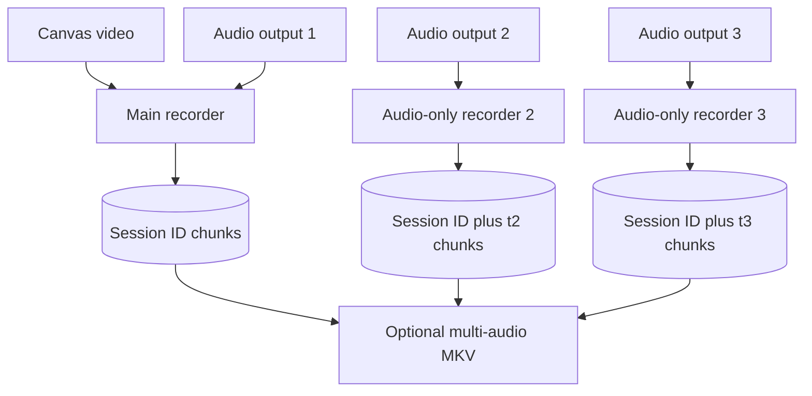

An illustrative configuration is track 1 `EVERYONE`, track 2 `VIP_ONLY`, and track 3 `ME`. This produces main presentation video with the broad mix, a separate VIP audio file, and a separate local-microphone file—provided those sources and routing conditions are satisfied.

| Output | Example filename | Contents |
| --- | --- | --- |
| Main raw | `meet-recording-<ts>_full.mkv` or `.webm` | Canvas video and first audio mix |
| Extra raw | `meet-recording-<ts>_track-2-VIP-ONLY.webm` | Second audio mix |
| Combined | `meet-recording-<ts>_combined.mkv` | Main video and all mapped audio streams |

The outputs are recorded at approximately the same time, but separate recorders start sequentially and native scheduling can differ. The combine command preserves their media timestamps; it does not perform an explicit alignment analysis or calculate per-track synchronization offsets.

Most media players select one audio stream at a time in the combined MKV. Switch tracks to hear another mix. Combining streams into a container is different from mixing all their sound into one signal.

Track names describe configured routing, not proof of clean voice isolation. The current combined-file metadata labels streams generically as `main-mix`, `track-1`, and so on; custom popup names are not all propagated as MKV titles.

## Installing the optional FFmpeg core

Recording and raw downloads work without FFmpeg. Optional combining requires these two local files:

```text
vendor/ffmpeg/ffmpeg-core.js
vendor/ffmpeg/ffmpeg-core.wasm
```

The reviewed wrapper uses the single-threaded UMD core from `@ffmpeg/core@0.12.6`. It builds its own Blob worker. Despite the older vendor README listing three files, this implementation does not require a separate `ffmpeg-core.worker.js` from that package.

**Linux/macOS setup example, from the repository root:**

```bash
mkdir -p vendor/ffmpeg
curl -fL https://unpkg.com/@ffmpeg/core@0.12.6/dist/umd/ffmpeg-core.js \
  -o vendor/ffmpeg/ffmpeg-core.js
curl -fL https://unpkg.com/@ffmpeg/core@0.12.6/dist/umd/ffmpeg-core.wasm \
  -o vendor/ffmpeg/ffmpeg-core.wasm
```

**PowerShell setup example:**

```powershell
$ffmpegDestination = "vendor\ffmpeg"
$ffmpegBaseUrl = "https://unpkg.com/@ffmpeg/core@0.12.6/dist/umd"
New-Item -ItemType Directory -Force $ffmpegDestination | Out-Null
Invoke-WebRequest "$ffmpegBaseUrl/ffmpeg-core.js" `
  -OutFile "$ffmpegDestination/ffmpeg-core.js"
Invoke-WebRequest "$ffmpegBaseUrl/ffmpeg-core.wasm" `
  -OutFile "$ffmpegDestination/ffmpeg-core.wasm"
```

These commands are documentation examples; recording does not automatically run them. Reload the extension and refresh Meet after installing files. `isAvailable()` checks both extension resource URLs with bounded HEAD requests and caches its result in that content-script instance, so a fresh instance matters after setup changes.

The WebAssembly file is roughly 31 MB in the reviewed local installation. During combining, it is loaded from the extension package, not uploaded with your recording to a remote conversion service. Internet access is needed for initial download and the Meet call; installed combining is local.

Keep JavaScript and WebAssembly from the same package version. A missing or incompatible core makes combining fail while raw data remains the fallback.

## The browser FFmpeg merge pipeline

FFmpeg combining begins after raw output saving, normally when the user chooses **Do it** for a retained multi-output recording. `runPendingCombine()` claims that specific job, rebuilds its main and secondary Blobs from storage, and calls the captured mux API.

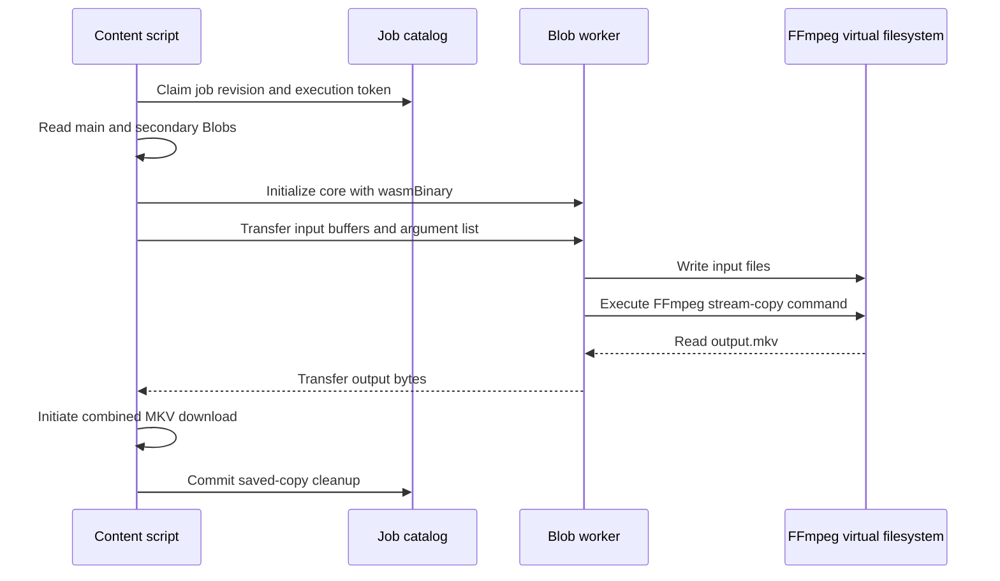

A content-script worker cannot simply be constructed from a `chrome-extension://` URL under the page-origin worker rules. The wrapper fetches the core JavaScript as text and WebAssembly as bytes, creates an inlined Blob-URL worker, and initializes the core with `wasmBinary`.

Input Blobs become typed arrays and are transferred to the worker. Its in-memory filesystem receives `input0.<ext>` and secondary `.webm` inputs. FFmpeg writes `output.mkv`; the wrapper reads and transfers those output bytes back as a Blob.

The worker removes inputs and partial output in `finally`, and the content operation terminates its captured mux owner. Initialization has a 30-second deadline; run operations have a ten-minute deadline. Large recordings can still exceed memory or time limits.

A successful remux initiates a combined download before stored chunks are deleted. Failures retain a recoverable job where applicable. This operation does not separate voices, fill missing chunks, or upload the files.

## FFmpeg stream mapping explained

**Source excerpt — `muxer.js`, argument construction:**

```javascript
const args = ['-y'];
files.forEach(f => args.push('-i', f.name));
args.push('-map', '0:v:0', '-map', '0:a:0');
for (let i = 1; i < files.length; i++) {
  args.push('-map', i + ':a:0');
}
args.push('-metadata:s:a:0', 'title=main-mix');
for (let i = 1; i < files.length; i++) {
  args.push('-metadata:s:a:' + i, 'title=track-' + i);
}
args.push('-c', 'copy', '-f', 'matroska', 'output.mkv');
```

Each `-i` introduces an input. Input 0 is the main video-plus-audio recording; input 1 and later are separate audio recordings. `-map 0:v:0` selects the first video's stream from input 0, and `-map 0:a:0` selects its first audio stream. Later maps add the first audio stream from every secondary input.

| Option | Meaning |
| --- | --- |
| `-y` | Allows replacement of the worker's temporary output file |
| `-map` | Explicitly chooses streams for the combined output |
| `-metadata:s:a:N` | Labels output audio stream N |
| `-c copy` | Copies encoded packets without re-encoding |
| `-f matroska` | Writes a Matroska container |

Stream copy avoids a full encode and preserves the captured codec quality. It still reads whole input files and writes a new container, so it has meaningful memory and processing costs in WebAssembly.

There is no concat filter here because these inputs represent parallel outputs, not successive meetings. There is no `amix` filter because the intended result retains separate selectable audio streams. There is also no `-shortest` or explicit timestamp-offset correction; output duration and alignment follow the available input media and FFmpeg's normal demux/mux behavior.

The mappings require a main video and main audio stream. If either is missing or malformed, the current command can fail. An output labeled VIP or a person's name will still contain any incorrect or mixed source audio recorded earlier.

## Manual FFmpeg repair and merging

A native desktop FFmpeg installation can remux raw downloaded files when browser combining is unavailable or too memory-intensive. These commands run manually on local files; they are not launched by the extension.

**Remux one main recording:**

```bash
ffmpeg -i "meeting_full.webm" \
  -map 0:v:0 -map 0:a:0 -c copy "meeting_remuxed.mkv"
```

**Combine one main recording and two parallel audio outputs:**

```bash
ffmpeg -i "meeting_full.webm" \
  -i "meeting_track-2.webm" -i "meeting_track-3.webm" \
  -map 0:v:0 -map 0:a:0 -map 1:a:0 -map 2:a:0 \
  -metadata:s:a:0 title="main-mix" \
  -metadata:s:a:1 title="VIP" \
  -metadata:s:a:2 title="ME" \
  -c copy "meeting_combined.mkv"
```

Use the actual main extension, which may already be `.mkv`. These examples omit `-y`, so FFmpeg asks before overwriting an existing output. Backslash continuation is for Bash; in PowerShell run one line or use its backtick continuation.

**Inspect stream contents and container duration:**

```bash
ffprobe -v error -show_streams -show_format "meeting_combined.mkv"
```

If you separately exported the original binary chunks of one recorder, join them in exact session order—including the first header chunk—before remuxing. On Bash, an explicit example is `cat chunk-0001.bin chunk-0002.bin chunk-0003.bin > joined.webm`. MeetBud already performs this joining in memory; its normal downloads are assembled files, so users usually need no chunk-export step.

FFmpeg concat is appropriate for compatible, separately finalized recordings that should play one after another. It is not the same operation as combining parallel audio tracks, and arbitrary MediaRecorder chunks may not be standalone inputs.

Preserve the original downloads while assessing a remuxed copy. Container repair cannot recreate missing audio or correct participant routing.

## Saved recordings and deferred combining

The extension stores recovery metadata independently for each recording in `chrome.storage.local`, using keys beginning with `meetBudyPendingCombine:` and an encoded recording ID. Media stays in Meet-origin IndexedDB; the catalog stores job identity and processing status.

A later recording does not replace an earlier deferred job. The popup lists retained recordings and scopes each action to the selected ID. Job status is separate from the active recording's controls and timer.

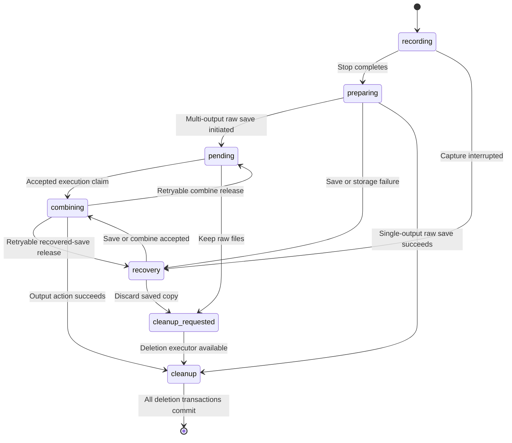

This diagram summarizes the ordinary transitions; detailed error and ownership checks remain in the code. A recovery action with no extra outputs can save the available main data and finish cleanup without invoking FFmpeg.

**Do it** runs a pending combine. **Later** sets the selected recording's next prompt about ten minutes ahead; it does not run a remote scheduler. The popup's timer and future catalog refreshes drive reminders. Other due recordings can still be offered.

**Save recording** downloads a recovered saved portion. **Keep raw files** or **Discard recording** removes the extension's saved copy according to context; neither deletes files already downloaded to the operating system. **Retry cleanup** attempts previously incomplete database deletion.

Treat an incomplete-save warning literally: retained data can be usable while missing media that failed to persist. Keep a suitable Meet-origin tab available for saved-data operations.

## Recovery and cleanup ownership

Recording data and recovery metadata have different storage owners. IndexedDB belongs to the Meet origin within a browser profile. The extension catalog belongs to extension local storage. A job can therefore exist while no suitable page is currently available to read its chunks.

The background routes saved-job actions to a tab on the matching origin, preferring the current execution owner or original recording tab where available. Recovery also scans stored recording IDs and groups secondary IDs under their main session. A scan can discover uncataloged stored portions; it cannot manufacture missing media.

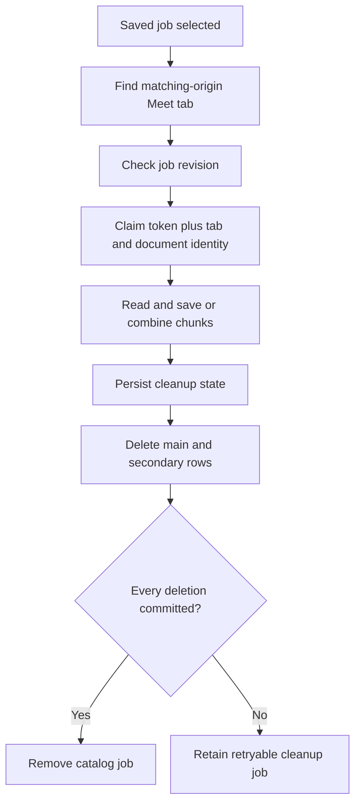

Catalog mutations are serialized and revision-checked. The original recording ID, origin, and source ownership stay stable. A combine claim adds an execution token and actual tab/document ownership; only the matching accepted owner may release that claim. A stale popup or late callback must not cancel another operation's ownership.

Cleanup persists its intent before deleting chunks. The job remains as a durable cleanup marker until every relevant deletion transaction commits. Failed or interrupted cleanup can then be retried instead of silently losing track of retained data.

Tab closure, reload, and service-worker restart require claim-liveness reconciliation. Known-dead execution owners can be released; unknown owners are preserved conservatively to avoid concurrent execution. Background emits tab-closure events, and the popup retires only state belonging to its matching selected tab.

Recovery is limited by what survives: clearing Meet site data, deleting the extension/profile, storage eviction, or missing headers can make recovery impossible. Normal Stop, download verification, and external retention of the finished file remain the dependable workflow.

## Resource lifetimes and leak prevention

The project distinguishes live-media services from resources owned by one recording or one combine operation. Stopping a recording must release its capture resources without breaking the live meeting or a later recording.

| Owner | Resources | Retirement condition |
| --- | --- | --- |
| Observed remote track | Source/gain/analyser nodes, muted sink, identity caches | Track ends or final peer ownership retires |
| Video probe | Probe element, metadata listeners, timers | Classification ends, track retires, or timeout |
| Recording session | Canvas stream, recorder callbacks, final events, writes | Final events and accepted writes drain |
| Compositor loop | Timer worker or interval | Pause/stop or failed setup |
| Download operation | Anchor and Blob URL | Scheduled disposal or setup failure |
| FFmpeg operation | Worker, URL, promises, fetches, virtual files | Completion, failure, deadline, cancellation |

Remote sources are intentionally reused across sessions because rebuilding a source for the same remote track can produce silence in the affected Chrome path. The hidden sink and source are live-track services, not automatically a leak just because a recording stopped.

An ended-event listener and a roughly one-second ready-state sweep retire tracks. The sweep matters because explicit `MediaStreamTrack.stop()` does not dispatch an `ended` event. Connection states such as `failed` or `disconnected` can recover, so the recorder preserves live track registrations until actual retirement rather than deleting them prematurely.

Capture cleanup stops session-owned canvas tracks, not Meet-owned remote media. It disconnects owned Web Audio nodes, clears references, removes sinks/probes where appropriate, and prevents old recorder callbacks from acting on a newer session.

FFmpeg cleanup aborts pending work, rejects waiting calls, terminates workers, revokes Blob URLs, and unlinks filesystem inputs/output. Partial allocation failures also need disposal; cleaning only the success path is insufficient.

## Performance and storage planning

Recording competes with the meeting for device resources. Canvas drawing targets 30 fps, audio analysers poll around 10 times per second, and every added output introduces another audio recorder. Participant mapping and media churn can increase work even when few tiles are visible.

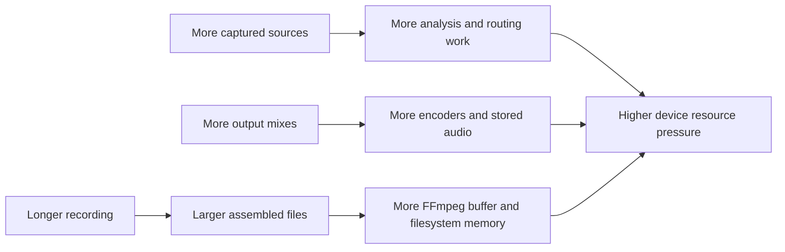

At the requested rates, one hour of main output is approximately:

```text
Video: 3,000,000 bits/s × 3,600 s ÷ 8 = 1.35 GB
Audio:   128,000 bits/s × 3,600 s ÷ 8 = 57.6 MB
Main total: about 1.408 GB per hour, before container overhead
Each additional audio output: about 57.6 MB per hour
```

These are decimal bitrate-based estimates, not measured file sizes. Encoder behavior can vary. The popup's chunk totals use 1,048,576-byte units even when the label says MB; do not equate that display directly with decimal gigabytes.

IndexedDB retention, raw downloaded files, and combined downloaded files can coexist temporarily. Combining also reads complete inputs into Blobs/typed arrays and copies them into FFmpeg's memory filesystem. There is no streaming-to-disk combine implementation or fixed safe-memory multiplier in this source.

For a large or long meeting, minimize output count, keep other heavy tasks closed, and perform a representative test. On a constrained device, use raw downloads and native desktop FFmpeg if browser remuxing is impractical. Finalization and combining may need time after capture stops.

## Troubleshooting and known limitations

| Symptom | Likely area | Useful next action |
| --- | --- | --- |
| No Meet tab found | Tab selection or page origin | Open the correct Meet page and refresh status |
| Zero voices despite remote speech | Injection or source setup | Inspect logs; reload extension and fresh Meet page after saving |
| Missing presentation | Probe/DOM classification | Confirm a real share; inspect stream status and transitions |
| Silent named/VIP output | Identity mapping or target gates | Test sources; retain a broad `EVERYONE` mix |
| Silent local microphone | Sender unavailable, muted, or excluded | Check Meet mic, YOUR MIC, and output targets |
| Unknown duration or poor seek | Container metadata | Try a capable player and FFmpeg remux on a copy |
| Combine unavailable | Missing/mismatched vendor core | Follow [Installing the optional FFmpeg core](#installing-the-optional-ffmpeg-core) and reload |
| Combine fails on a large recording | Memory, timeout, or malformed media | Keep raw files and try native FFmpeg |
| Recovery needs a tab | Meet-origin storage executor absent | Open a matching-origin Meet tab in the same profile |
| Cleanup still listed | Deletion did not finish | Use Retry cleanup; preserve the retryable job |

Historical warnings cover share changes, pause, re-injection, and saving. Current lifecycle tests address several causes; native Chrome/Meet validation remains necessary.

Named/VIP outputs remain unreliable in large meetings; additional tracks and FFmpeg cannot isolate voices from mixed or unidentified sources.

Other limits include heuristic video classification, background throttling, timing differences between recorders, download initiation without completion tracking, and recovery restricted to persisted media.

For diagnosis, use popup Logs, the Meet tab console prefixes `[MeetRecorder]`, `[MeetBudyMuxer]`, and `[ffmpeg]`, and the background service worker inspector. The page helper `window.__meetRecDumpDOM()` exposes relevant DOM diagnostics. Inspect such information locally; avoid placing participant names or meeting content in shared reports unnecessarily.

## Verification and development guide

The repository's regression tests execute real source against simulated browser and extension APIs. Run them with Node.js 18 or later, without a dependency install:

```bash
node --test tests/page-lifecycle.test.cjs \
  tests/extension-lifecycle.test.cjs
```

For this documentation pass, **100 tests passed, zero failed, and zero skipped**. The optional real FFmpeg core was present locally, so its filesystem/cleanup integration case ran. These results apply to the reviewed source snapshot; they are not a recording benchmark or proof of correct playback from a real call.

Coverage includes track retirement, source/sink/probe cleanup, duplicate injection, startup cancellation, final recorder/write draining, immutable output metadata, worker failure/cancellation, catalog revisions, saved-job ownership, and tab-scoped popup behavior.

Native validation should exercise:

1. A short call with remote audio, first with YOUR MIC off and then on.
2. Recording without a presentation, then starting, stopping, and replacing a share.
3. Multiple outputs, inspecting each raw file and selecting every combined MKV audio track.
4. Pause/resume if that workflow matters, including duration and seeking checks.
5. A large call's named/VIP behavior, expecting the limits in [Why voice separation fails in large meetings](#why-voice-separation-fails-in-large-meetings).
6. Save/recovery/cleanup across page reload or unavailable-tab conditions, using expendable test media.
7. Memory and playback after a representative long session.

After edits, reload both extension and Meet. A cross-context feature needs compatible popup dispatch, background routing, content bridge handling, and page-world handling where applicable. Preserve session identities, source reuse, raw-save ordering, and exact worker ownership.

There is no configured application build or lint pipeline in the reviewed project. Syntax checks and these tests are useful, but browser media, Chrome downloads, native memory, and evolving Meet UI require real observation. The included screenshots verify the actual popup interface, not media capture.

## Privacy, glossary, and references

The manifest grants `storage`, `downloads`, `activeTab`, `scripting`, and `tabs`, with host access to `https://meet.google.com/*`. It exposes the injected script, muxer, background image, and two FFmpeg core resources to matching pages. Extension-page CSP permits local scripts and WebAssembly evaluation.

The extension's recording pipeline has no server-upload feature. Meet itself still communicates over the network, optional setup downloads code from a CDN, and participant avatar images may come from Google-hosted URLs. “Local recording” does not mean every page resource is offline.

Saved chunks contain meeting media and remain associated with the Meet origin and browser profile until cleanup or storage removal. The extension does not implement separate recording encryption or a secret-authenticated page message channel. Record with participant permission and handle retained/downloaded media according to the meeting's requirements.

| Term | Meaning in this project |
| --- | --- |
| WebRTC track | Live media source received or sent by the page |
| Chunk | Encoded Blob emitted by a local recorder |
| Assembly | Joining one session's ordered chunks |
| Mix | Combining selected source audio into one output signal |
| Remux | Writing existing encoded streams into a new container |
| MKV | Matroska file that can carry video and multiple audio streams |
| Recovery job | Durable metadata describing a saved recording action |
| Execution claim | Token and tab/document ownership for one saved action |

**Project references:** `manifest.json`; `injected.js` (`startRecording`, `persistRecordingChunk`, `finalizeRecording`, `rebuildAudioGraph`, `getParticipantForTrack`); `content_script.js` (`assembleAndDownload`, `runPendingCombine`, `cleanupJob`); `muxer.js` (`muxToMkv`, worker/disposal helpers); `background.js`; `popup/`; `tests/`; `docs/memory-leak-fixes.md`.

**API references:** [MediaRecorder](https://developer.mozilla.org/en-US/docs/Web/API/MediaRecorder), [WebRTC track events](https://developer.mozilla.org/en-US/docs/Web/API/RTCPeerConnection/track_event), [IndexedDB](https://developer.mozilla.org/en-US/docs/Web/API/IndexedDB_API), [Web Audio](https://developer.mozilla.org/en-US/docs/Web/API/Web_Audio_API), [Chrome extensions](https://developer.chrome.com/docs/extensions/), [FFmpeg documentation](https://ffmpeg.org/ffmpeg.html), and [Mermaid syntax](https://mermaid.js.org/intro/).

The source excerpts and examples are explanatory snapshots of the reviewed implementation. Follow the current code when later changes alter behavior, and repeat native verification before relying on a new browser or Meet version.
